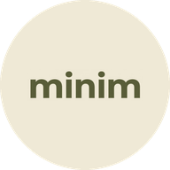

<p align="center">
  
</p>

<h1 align="center">Minim</h1>

<p align="center">
  A lightweight, minimal YouTube Music client for Android.<br>
  Search, a clean player, your library and a few fun extras. Nothing else.
</p>

<p align="center">
  <a href="https://github.com/UniquelyGaurab/minim/releases/latest"><b>Download</b></a> ·
  <a href="CHANGELOG.md">Changelog</a> ·
  <a href="#build-from-source">Build</a> ·
  <a href="#privacy">Privacy</a>
</p>

<p align="center">Android 9 and newer · about 9.3 MB · GPL-3.0</p>

---

## Install

1. Download the latest `Minim-vX.Y.Z.apk` from [Releases](https://github.com/UniquelyGaurab/minim/releases/latest).
2. Open it on your phone and allow installs from your browser or file manager if Android asks.

After that, Minim keeps itself up to date. When it opens, or comes back after a few hours, it checks this repo's latest release and offers to download and install it. You can also check any time in Settings. What changed in each version is in [CHANGELOG.md](CHANGELOG.md).

## Features

### Listening

- **Search and play** songs from YouTube Music, streamed through NewPipe Extractor. No account needed.
- **Radio queue** keeps playing similar songs after the one you picked.
- **Up next** stretches out of its pill on Now Playing. Drag ≡ to reorder, tap × to remove.
- **Track fade** between songs (Off, 2 or 4 seconds).
- **Volume boost** (Off, Normal, Loud) for quiet songs, and **Bass boost** (Off, Warm, Punchy, Heavy) with a limiter so it never crackles.
- **Sleep timer** in Now Playing's menu: 15 to 60 minutes, a custom time, or the end of the song.
- **Save offline** in the best quality YouTube offers, with lyrics and cover, so songs play with no signal.

### Lyrics

- **Synced lyrics** from LRCLib, lit up word by word (Flow) or line by line, with a timing adjustment.
- **Full screen lyrics** over a blurred cover. Tap any line to jump there.
- **Translation** shows the English meaning under each line of non-English songs, using Gemini.
- **Gemini lyrics** for songs with none: tap **Get lyrics with Gemini** and it listens to the song and writes synced lyrics with your own AI Studio key. They're saved on your phone and marked "Generated by AI · might not be accurate". Real lyrics always win if the song gets some later.

### tapes

- **YouTube channels as audio.** Follow a channel and its uploads play like songs, without the video. Shorts stay out.
- **Shelves:** Continue listening, New this week and one row per channel, with **Under 20 mins**, **30+ mins** and **New to You** chips.
- **Picks up where you stopped**, even after a restart.
- **Channel pages** with Follow, Latest and Popular.
- **Captions** in full screen lyrics, and a **playback speed** (1x to 2x) kept per channel.

### Library and discovery

- **Liked** songs, tapes and artists, playlists, recents and offline downloads.
- **Import playlists** from YouTube, YouTube Music, Spotify or a plain list of songs, then review the matches before saving.
- **Discover** on the Search page: shelves picked from what you listen to, your top artists and a daily shelf picked by Gemini.
- **Artist pages** with a full-bleed photo, monthly listeners, top songs, albums and Shuffle.

### Stats and recap

- **Stats** for today's listening time, songs, artists, tapes and your streak. Every repeat-one loop counts as a play.
- **Daily recap story** with the day's top song playing behind it: time listened, your day in hours, a guess-your-top-song game, the top 5, top artist, a roast, your listening personality and more.
- **A 9:16 card** to share or save, and the day's top songs saved as a playlist in one tap.

### Ask Gemini

A chat that finds, plays and queues songs, opens artist pages, explains or translates lyrics, roasts your stats and builds playlists. Pick the model and add your own free key in Settings → Gemini.

### Look and feel

- **Dynamic colours** taken from the cover of the song that's playing, or a black and white **Default** mode. Light and dark themes.
- **Smooth motion:** the mini player turns into Now Playing, colours fade between songs, and the heart bursts when you like a song. **Remove animations** turns it all off.
- **Rotating greetings** on Home, including lines about what you're playing and how much you've listened.
- **Festival themes** with their own wallpaper, colours and greetings.
- **Haptic feedback**, album art gestures and HD artwork.
- **Tidy Settings** in eight short groups, with option pills that slide over when you pick one.

### Account

- **Optional Google sign-in** backs up your likes, playlists, stats and history and syncs them across phones. Minim works fully without it.
- **Crash screen:** if Minim ever crashes, it shows what happened next time, with Copy and Share. Nothing is sent unless you share it.

## Privacy

Minim works without signing in. This is everything that leaves your phone, and when.

- **Google sign-in (optional):** Minim only gets your name, profile picture and email. It never sees your password and can't access your Gmail, Drive, contacts or anything else in your Google account. Sync stores song IDs, song details (title, artist, cover link, length) and times under your own account, and **Delete account** in Settings removes all of it. Settings stay on the phone.
- **Gemini chat:** messages go to Google Gemini; on the free tier Google may use them to improve its models. Only what you type, the song you attach and what Gemini asks Minim for (song details, lyrics, your likes, recent songs and listening stats) are sent. The chat isn't saved and is wiped when you close the app.
- **Lyrics translation:** when you tap translate, the song's lyrics, title and artist go to Google Gemini, and nothing else. The translation is saved only on your phone.
- **Gemini lyrics:** only when you tap **Get lyrics with Gemini**, the song's audio, title and artist go to Google Gemini with your own key. The lyrics are saved only on your phone.
- **Gemini shelf on Search:** at most once a day, a short summary of what you play (top songs and artists, recent plays and likes, as titles and artist names) goes to Google Gemini to pick that day's shelf. The shelf is saved only on your phone.
- **Your API key**, if you add one, is encrypted on your phone, left out of Android backups, and never synced or logged.
- **tapes:** the channels you follow, your place in each tape and your speed for each channel are saved only on your phone.

## Build from source

You need JDK 17 and the Android SDK with platform 34 and build-tools 34.0.0.

```bash
git clone https://github.com/UniquelyGaurab/minim.git
cd minim
echo "sdk.dir=/path/to/your/Android/Sdk" > local.properties   # or set ANDROID_HOME
./gradlew assembleDebug
```

The APK lands in `app/build/outputs/apk/debug/app-debug.apk`. Run the tests with `./gradlew testDebugUnitTest`.

**No Firebase file needed.** Without one, Minim builds and runs the same, and the Account section in Settings stays hidden.

<details>
<summary><b>Firebase (optional): sign-in, sync and built-in Gemini</b></summary>

<br>

Sign-in, sync and the config document need your own Firebase project. Follow [FIREBASE_SETUP.md](FIREBASE_SETUP.md): create a project, put its `google-services.json` in `app/` (see `app/google-services.json.example`; the real file is ignored by git and must never be committed), and publish the rules in [`firestore.rules`](firestore.rules).

The Gemini chat's built-in route uses Firebase AI Logic in the same project (step 4 in FIREBASE_SETUP.md). Without it, the chat still works with your own key from [Google AI Studio](https://aistudio.google.com/apikey), added in Settings → Gemini.

If your project enforces App Check on Firebase AI Logic, each phone needs its debug token added: copy it from Settings → Gemini → Your device token, then in the Firebase console go to App Check → Apps → your app → Manage debug tokens → Add. The token stays on the phone, never synced, backed up or logged.

</details>

<details>
<summary><b>Signing with your own key</b></summary>

<br>

Debug builds are signed with the standard Android debug key on your machine. To use a specific key, create `keystore.properties` in the project root (it is ignored by git and must never be committed):

```properties
storeFile=minim.keystore
storePassword=your-store-password
keyAlias=your-key-alias
keyPassword=your-key-password
```

Android only installs an update over an existing app when both are signed with the same key.

</details>

## Greetings and festival themes

Both live in this repo, so they change without an app update.

- **Greetings:** Home picks up new lines from [`greetings/greetings.json`](greetings/greetings.json) within about 10 minutes. [`greetings/README.md`](greetings/README.md) shows how to edit it from your phone, with every field and placeholder.
- **Festival themes:** wallpapers, colours, greetings and like bursts live in [`themes`](themes). [`themes/README.md`](themes/README.md) shows how to add one.

## Credits

Designed by **Gaurab**, built by **Charlie (Sesame AI)**, early code by **Google Gemini**.

- [NewPipe Extractor](https://github.com/TeamNewPipe/NewPipeExtractor) for search and streams (GPL-3.0)
- [LRCLib](https://lrclib.net) for synced lyrics
- [AndroidX Media3 / ExoPlayer](https://github.com/androidx/media) for playback
- [OkHttp](https://github.com/square/okhttp) for networking
- [Firebase](https://firebase.google.com) Authentication and Cloud Firestore for the optional sign-in and sync
- [Google Gemini](https://ai.google.dev) (Gemini API and Firebase AI Logic) for the chat, translation, lyrics and the Search shelf
- [Poppins](https://fonts.google.com/specimen/Poppins) font (SIL Open Font License)
- [Simple Icons](https://simpleicons.org) for the one-colour Spotify, YouTube Music and YouTube logos (CC0; the logos are their owners' trademarks)

Minim is not affiliated with YouTube or Google.

## License

Minim is free software under the [GNU General Public License v3.0](LICENSE).

Author: [UniquelyGaurab](https://github.com/UniquelyGaurab)
