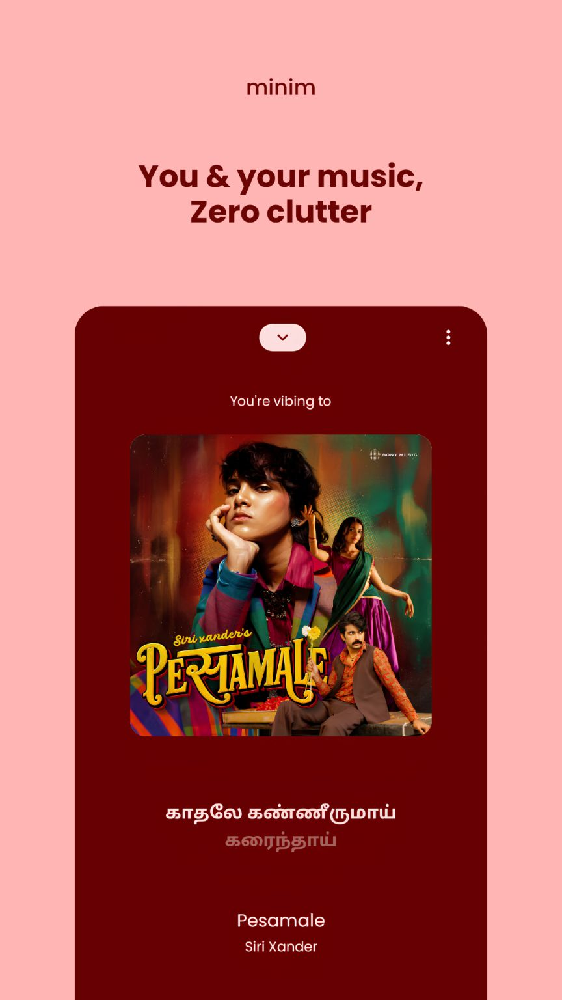
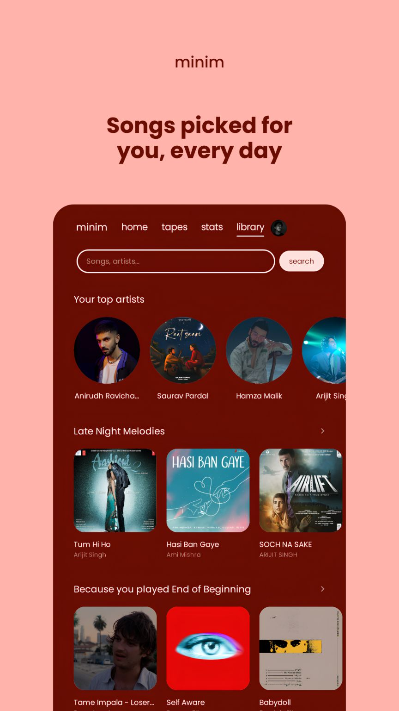
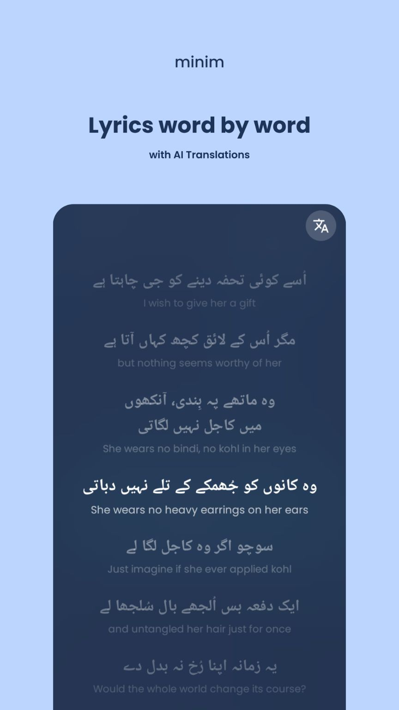
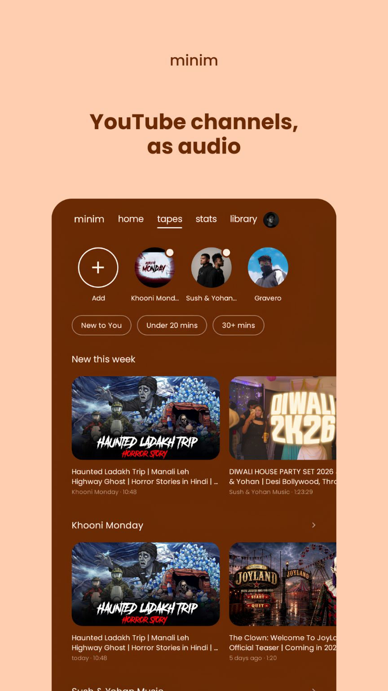
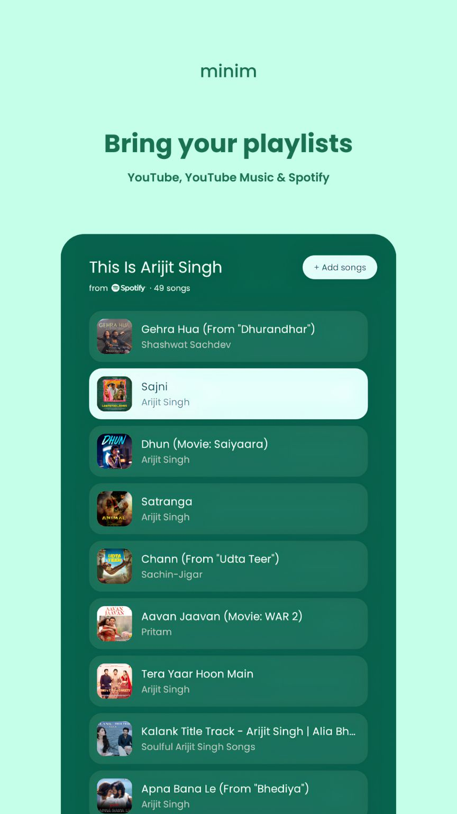
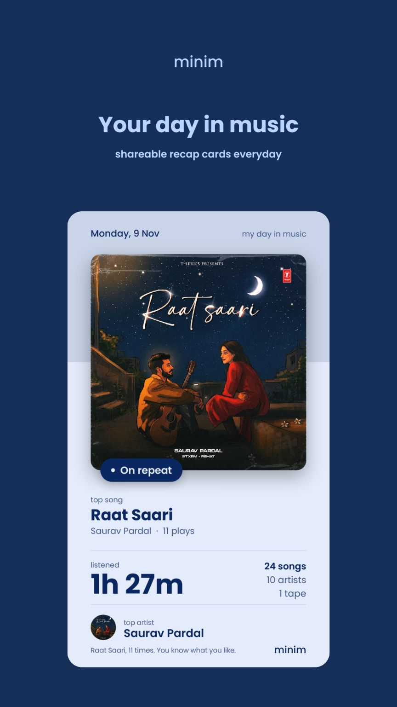

<p align="center">
  
</p>

<h1 align="center">Minim</h1>

<p align="center">
  A lightweight, minimal YouTube Music client for Android.<br>
  No account, no Firebase, no data collection. Your music life stays on your phone.
</p>

<p align="center">
  <a href="https://github.com/UniquelyGaurab/minim/releases/latest"><b>Download</b></a> ·
  <a href="CHANGELOG.md">Changelog</a> ·
  <a href="#minim-fermata">Minim Fermata</a> ·
  <a href="#privacy">Privacy</a> ·
  <a href="#build-from-source">Build</a>
</p>

<p align="center">Android 9 and newer · about 8 MB · GPL-3.0</p>

<p align="center">
  &nbsp;
  &nbsp;
  
</p>
<p align="center">
  &nbsp;
  &nbsp;
  
</p>

---

## What Minim is

Minim plays YouTube Music without the clutter. Songs are found and streamed with [NewPipe Extractor](https://github.com/TeamNewPipe/NewPipeExtractor), lyrics come from [LRCLib](https://lrclib.net), and everything else (your likes, playlists, history, stats and settings) lives on your phone. There's nothing to sign in to and no API key to set up before you press play.

## New in V6

- **No accounts.** Google sign-in is gone. Minim doesn't know who you are and doesn't need to.
- **No Firebase, zero data collection.** There's no Minim server, no analytics and no cloud copy of your library. The Firebase and Google sign-in code is removed from the app entirely.
- **Everything stays on your phone.** Your library and history are kept by Minim Fermata, on the device. Your profile photo never leaves the phone, not even in backups.
- **Minim Fermata.** Minim's own on-device engine for your library, history, recommendations, backups and syncing between phones. [More below.](#minim-fermata)
- **Recommendations that never leave your phone.** The radio and Discover are put in your order by Minim Fermata, from what you like, play and skip.
- **Backups and syncing through a folder you pick.** Minim backs up when you leave the app and once a day, only adding what's new, and picks up your other phones' changes when you open it.
- **Your own Gemini key.** Lyrics translation, Gemini lyrics, the chat and the daily Search shelf use a free key from Google AI Studio that you add yourself.

Coming from 5.x or 6.0? 6.5 installs as an update and keeps your library, likes, playlists, stats and settings. The first line in Settings, "No accounts. No cloud. Nobody watching you skip the same song at 3am.", opens to explain why Google sign-in went and Minim went fully local. Tap it again to fold it.

## Minim Fermata

A fermata is the music symbol that says "hold this note longer". Minim Fermata is the part of Minim that holds on to your music life, on your phone and nowhere else. It's developed in its own repo, [minim-fermata](https://github.com/UniquelyGaurab/minim-fermata), and built into Minim from source.

What it does:

- **Keeps an on-device log** of everything you do in your library: likes and unlikes, playlist edits, "not interested", plays, skips and tapes. Your library, history and stats are built from that log, and each change is saved together with what the screens show, so closing Minim mid-song can't leave them disagreeing.
- **Backs up** the log to a folder you pick. The first backup holds your whole history; after that, each backup only adds a small `.fermata` file with what's new, and now and then the small files are combined into one. Your Gemini key and other settings are never written to a backup.
- **Restores** any backup in that folder, from this phone or another one. A restore is merged into what's already on the phone; it never wipes the phone first.
- **Merges your phones.** Phones that back up into the same folder pick up each other's likes, playlists and plays, without counting anything twice. When two phones disagree (a like on one, an unlike on the other), the newer change wins on both.
- **Clears history everywhere.** Clear history removes your plays, stats and listening time from this phone, your backups and your other phones. Likes and playlists stay.
- **Recommendations, on your phone.** YouTube still picks the songs for the radio and Discover's mixes, and Minim Fermata puts them in your order from what you like, play and skip. Songs you skip early move down, a song you've skipped early twice in a row is left out until you play it again, and "Not interested" hides a song from Discover and the radio (with Undo). Discover also gets "Because you like", "Forgotten favourites" and "On repeat". New listeners get the old order until Minim has heard about 30 plays across 10 songs. None of it uses the network: it's worked out on the device from your own log.

## Install

1. Download `Minim-v6.5.0.apk` (or whatever the newest is) from [Releases](https://github.com/UniquelyGaurab/minim/releases/latest).
2. Open it on your phone and allow installs from your browser or file manager if Android asks.

After that, Minim keeps itself up to date. When it opens, or comes back after a few hours, it checks this repo's latest release and offers to download and install it. You can also tap Check for updates in Settings → About. Each release installs over the one before and keeps your library and settings. What changed in each version is in [CHANGELOG.md](CHANGELOG.md).

## Features

### Listening

- **Search and play** songs from YouTube Music, streamed through NewPipe Extractor.
- **Radio queue** keeps playing similar songs after the one you picked.
- **Up next** stretches out of its pill on Now Playing. Drag ≡ to reorder, tap × to remove.
- **Track fade** between songs (Off, 2 or 4 seconds).
- **Volume boost** (Off, Normal, Loud) for quiet songs, and **Bass boost** (Off, Warm, Punchy, Heavy) with a limiter so it never crackles.
- **Sleep timer** in Now Playing's menu: 15 to 60 minutes, a custom time, or the end of the song.
- **Save offline** in the best quality YouTube offers, with lyrics and cover, so songs play with no signal.

### Lyrics

- **Synced lyrics** from LRCLib, lit up word by word (Flow) or line by line, with a timing adjustment.
- **Full screen lyrics** over a blurred cover. Tap any line to jump there.
- **Translation** shows the English meaning under each line of non-English songs, using Gemini.
- **Gemini lyrics** for songs with none: tap **Get lyrics with Gemini** and it listens to the song and writes synced lyrics. They're saved on your phone and marked "Generated by AI · might not be accurate". Real lyrics always win if the song gets some later.

### tapes

- **YouTube channels as audio.** Follow a channel and its uploads play like songs, without the video. Shorts stay out.
- **Shelves:** Continue listening, New this week and one row per channel, with **Under 20 mins**, **30+ mins** and **New to You** chips.
- **Picks up where you stopped**, even after a restart.
- **Original audio:** a video with dubbed tracks always plays its original language.
- **Channel pages** with Follow, Latest and Popular.
- **Captions** in full screen lyrics, and a **playback speed** (1x to 2x) kept per channel.

### Library and discovery

- **Liked** songs, tapes and artists, playlists, recents and offline downloads.
- **Search your playlists** by name from the pill at the top of Library.
- **Import playlists** from YouTube, YouTube Music, Spotify or a plain list of songs, then review the matches before saving.
- **Discover** on the Search page: shelves picked from what you listen to, your top artists and a daily shelf picked by Gemini.
- **Artist pages** with a full-bleed photo, monthly listeners, top songs, albums and Shuffle.

### Stats and recap

- **Stats** for today's listening time, songs, artists, tapes and your streak. Every repeat-one loop counts as a play.
- **Daily recap story** with the day's top song playing behind it: time listened, your day in hours, a guess-your-top-song game, the top 5, top artist, a roast, your listening personality and more.
- **A 9:16 card** to share or save, and the day's top songs saved as a playlist in one tap.

### Ask Gemini

A chat that finds, plays and queues songs, opens artist pages, explains or translates lyrics, roasts your stats and builds playlists. Pick the model in Settings → Gemini.

### You

- **Profile** at the top of Settings: your name and a round photo from the gallery or the camera. Your name is the one the Home greetings use, and your photo or first letter shows in the top bar. Both stay on this phone.
- **Crash screen:** if Minim ever crashes, it shows what happened next time, with Copy and Share. Nothing is sent unless you share it.

### Look and feel

- **Dynamic colours** taken from the cover of the song that's playing, or a black and white **Default** mode. Light and dark themes.
- **Smooth motion:** the mini player turns into Now Playing, colours fade between songs, and the heart bursts when you like a song. **Remove animations** turns it all off.
- **Rotating greetings** on Home, including lines about what you're playing and how much you've listened.
- **Festival themes** with their own wallpaper, colours and greetings.
- **Haptic feedback**, album art gestures and HD artwork.
- **Tidy Settings:** a one-line note on why there's no account (tap to read it), Profile, Backup & restore, then short groups for Look, Sound, Lyrics, Gestures, Gemini, Storage and About, with Clear history on its own at the bottom.

## Backups and syncing your phones

Backups are optional, and they go only where you put them.

1. Open Settings → Backup & restore and choose a backup folder. Android asks you to pick it, so Minim needs no storage permission and can only see that one folder.
2. That's it. Minim backs up when you leave the app (only if something changed), once a day while your phone is charging, and whenever you tap **Back up now**. The first backup writes your whole history; after that, each one only adds a small file with what's new (about 1 KB after one play), so backups are about a third of the size they used to be. Now and then Minim combines the small files into one, and only deletes old files once the new one is safely written. It also keeps a restore point from up to a day before. The line under Backup shows when the last one ran, or why it failed.

**Restore:** tap Restore and pick any backup in the folder, from this phone or another one. A fresh install offers to restore once, and you can say no.

**Sync two or more phones:** point each phone at the same folder, kept in sync by an app you already trust, such as Google Drive, Nextcloud, Dropbox or Syncthing. Each phone writes its own backup there, and when you open Minim it merges in what the other phones changed. Update every phone to 6.5 or newer, because 6.0.0 can't read 6.5 backups. Minim never talks to those services itself; it only reads and writes files in the folder.

Backups hold your likes, playlists and listening history. They don't hold your settings, your Gemini key or your profile photo. A backup file isn't encrypted, so pick a folder you trust.

Separately, if Google backup is turned on for your phone, Android can save Minim's library and settings with it, as it does for most apps. Your Gemini key and profile photo are always left out.

## Gemini with your own key

Minim has no built-in Gemini anymore. To use lyrics translation, Gemini lyrics, the chat and the daily Search shelf, get a free API key from [Google AI Studio](https://aistudio.google.com/apikey) and paste it in Settings → Gemini. Until you do, those features show an **Add your key** button instead. Everything else in Minim works without a key.

Your key is encrypted on your phone, left out of Android backups and Minim backups, and never synced or logged. Requests go straight from your phone to Google with your key.

## Privacy

Minim has no account, no server of its own and no analytics. Your library, history, stats, profile and settings are stored on your phone. This is everything that leaves it, and when.

- **Music:** searching, playing and saving songs and tapes talks to YouTube through NewPipe Extractor, with no account. Album art loads from YouTube's image servers.
- **Lyrics:** the song's title and artist go to LRCLib to find its lyrics.
- **Playlist import:** when you import a playlist, Minim reads it from YouTube or Spotify.
- **Updates, greetings and festival themes:** Minim checks this repo's latest release on GitHub and downloads the greetings and themes files from this repo.
- **Backups:** written only to the folder you pick. If that folder syncs to a cloud service, that service gets the file, under your account with it.
- **Gemini chat:** messages go to Google Gemini with your own key; on the free tier Google may use them to improve its models. Only what you type, the song you attach and what Gemini asks Minim for (song details, lyrics, your likes, recent songs and listening stats) are sent. The chat isn't saved and is wiped when you close the app.
- **Lyrics translation:** when you tap translate, the song's lyrics, title and artist go to Google Gemini, and nothing else. The translation is saved only on your phone.
- **Gemini lyrics:** only when you tap **Get lyrics with Gemini**, the song's audio, title and artist go to Google Gemini. The lyrics are saved only on your phone.
- **Gemini shelf on Search:** at most once a day, and only with your key, a short summary of what you play (top songs and artists, recent plays and likes, as titles and artist names) goes to Google Gemini to pick that day's shelf. The shelf is saved only on your phone.
- **Crash reports:** never sent on their own. You can copy or share one from the crash screen if you want to.

## Build from source

You need JDK 17 and the Android SDK with platform 34 and build-tools 34.0.0. Minim Fermata is a git submodule, so fetch it too.

```bash
git clone https://github.com/UniquelyGaurab/minim.git
cd minim
git submodule update --init
export ANDROID_HOME=/path/to/your/Android/Sdk
./gradlew assembleDebug
```

If you'd rather use `local.properties` than `ANDROID_HOME`, put the same `sdk.dir=/path/to/your/Android/Sdk` line in both `local.properties` and `fermata/local.properties`, because Minim Fermata is built as its own Gradle project.

The APK lands in `app/build/outputs/apk/debug/app-debug.apk`. Run the tests with `./gradlew testDebugUnitTest`, and Minim Fermata's own tests with `./gradlew test` inside `fermata/`.

The submodule is pinned to one commit of [minim-fermata](https://github.com/UniquelyGaurab/minim-fermata), and Gradle builds it together with the app. If you see "The fermata submodule is missing", run `git submodule update --init`. No Firebase file, API key or other setup is needed.

<details>
<summary><b>Signing with your own key</b></summary>

<br>

Debug builds are signed with the standard Android debug key on your machine. To use a specific key, create `keystore.properties` in the project root (it is ignored by git and must never be committed):

```properties
storeFile=minim.keystore
storePassword=your-store-password
keyAlias=your-key-alias
keyPassword=your-key-password
```

Android only installs an update over an existing app when both are signed with the same key.

</details>

## Greetings and festival themes

Both live in this repo, so they change without an app update.

- **Greetings:** Home picks up new lines from [`greetings/greetings.json`](greetings/greetings.json) within about 10 minutes. [`greetings/README.md`](greetings/README.md) shows how to edit it from your phone, with every field and placeholder.
- **Festival themes:** wallpapers, colours, greetings and like bursts live in [`themes`](themes). [`themes/README.md`](themes/README.md) shows how to add one.

## Credits

Designed by **Gaurab**, built by **Charlie (Sesame AI)**.

- **Dev**, for [Minim Fermata](https://github.com/UniquelyGaurab/minim-fermata) (Apache-2.0)
- [NewPipe Extractor](https://github.com/TeamNewPipe/NewPipeExtractor) for search and streams (GPL-3.0)
- [LRCLib](https://lrclib.net) for synced lyrics
- [AndroidX Media3 / ExoPlayer](https://github.com/androidx/media) for playback
- [AndroidX WorkManager](https://developer.android.com/topic/libraries/architecture/workmanager) for backups that still happen after you close the app
- [OkHttp](https://github.com/square/okhttp) for networking
- [Google Gemini API](https://ai.google.dev) for the chat, translation, lyrics and the Search shelf, with your own key
- [Poppins](https://fonts.google.com/specimen/Poppins) font (SIL Open Font License)
- [Simple Icons](https://simpleicons.org) for the one-colour Spotify, YouTube Music and YouTube logos (CC0; the logos are their owners' trademarks)

Minim is not affiliated with YouTube or Google.

## License

Minim is free software under the [GNU General Public License v3.0](LICENSE).

Author: [UniquelyGaurab](https://github.com/UniquelyGaurab)
